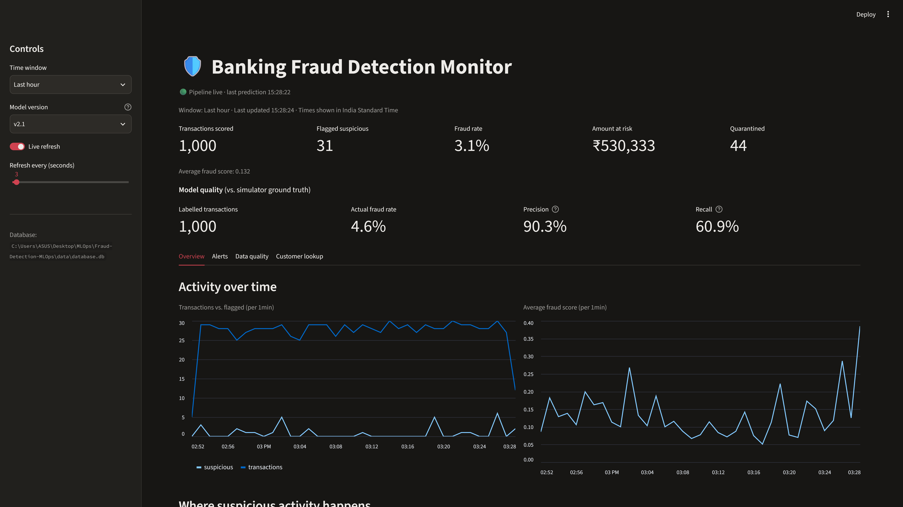
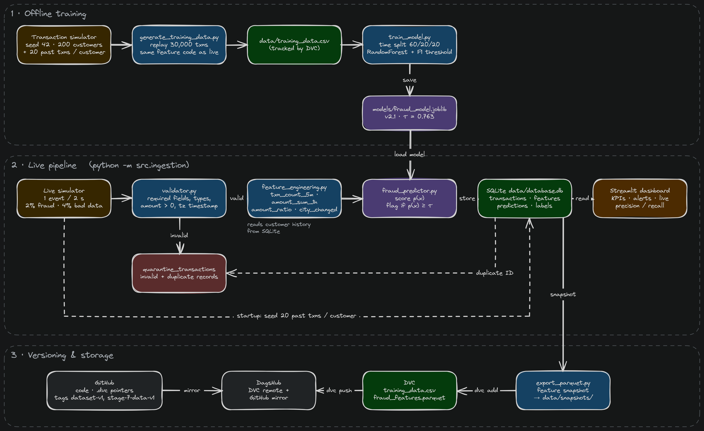

# Fraud-Detection-MLOps

Real-time banking fraud detection pipeline: synthetic transactions are validated,
enriched with behavioural features, scored by a trained model and stored in SQLite,
with a Streamlit dashboard for live monitoring.



## How it works



1. **Simulator** (`src/transaction_generator.py`) produces a stream of transactions
   from 200 customers, each with a home city, usual device and typical spend.
   2% of events start a labelled fraud episode (amount spike, new city and/or
   rapid burst); with bursts, about 5% of transactions are fraud.
   Customer profiles are fixed (seeded), and on startup ingestion seeds ~20
   past transactions per customer so behavioural features work from the
   first live event. About 4% of live events are deliberately malformed or
   duplicate records, to exercise validation and quarantine.
2. **Validation** (`src/validator.py`) rejects malformed transactions into
   `quarantine_transactions`.
3. **Feature engineering** (`src/feature_engineering.py`) computes
   `txn_count_5m`, `amount_sum_1h`, `amount_ratio` and `city_changed`
   from the customer's history.
4. **Prediction** (`src/fraud_predictor.py`) scores the transaction and
   applies the tuned threshold.
5. **Dashboard** (`app/dashboard.py`) shows live activity, alerts, data quality,
   and live precision / recall against the simulator's ground-truth labels.

Training data is produced by replaying the same simulator through the same
feature code, so training and serving features match.

**How the model works:** [`docs/model.md`](docs/model.md) covers the
distributions the simulator uses (and where in the code), the feature
formulas, the random forest, threshold tuning, and the evaluation metrics.
Model v2.1 on the held-out test set: precision 0.86, recall 0.80, ROC AUC 0.97.

## Project structure

```
├── src/                     # core pipeline package
│   ├── config.py            # project paths (data, models, database)
│   ├── database.py          # SQLite schema, indexes and insert helpers
│   ├── transaction_generator.py
│   ├── validator.py
│   ├── feature_engineering.py
│   ├── fraud_predictor.py
│   └── ingestion.py         # live ingestion service
├── scripts/                 # one-off jobs
│   ├── generate_training_data.py
│   ├── train_model.py
│   ├── export_parquet.py    # snapshot features to data/snapshots/*.parquet
│   └── view_transaction.py
├── app/
│   └── dashboard.py         # Streamlit monitoring dashboard
├── tests/                   # pytest suite (uses temporary databases)
├── docs/                    # model.md, flow diagram, dashboard screenshot
├── data/                    # training_data.csv, database.db (local only), snapshots/
└── models/                  # trained model artifact
```

## Usage

Run every command from the project root.

```bash
pip install -r requirements.txt

python -m scripts.generate_training_data   # build training data
python -m scripts.train_model              # train model + tune threshold
python -m scripts.export_parquet           # export feature snapshot to Parquet

# In two separate terminals:
python -m src.ingestion                    # start the live pipeline (run ONE instance)
streamlit run app/dashboard.py             # open the dashboard

python -m pytest                           # run tests
```

The dashboard only shows new data while `src.ingestion` is running. It
shows a warning when no prediction has arrived for 30 seconds.

## Data versioning (DVC + DagsHub)

`data/training_data.csv` and `data/snapshots/fraud_features.parquet` are
tracked by DVC, not Git. Git stores only the small `.dvc` pointer files;
the data lives on the DagsHub remote
`https://dagshub.com/junaaaak/Fraud-Detection-MLOps.dvc`.

One-time auth setup (stored in the git-ignored `.dvc/config.local`):

```bash
dagshub login
dvc remote modify dagshub --local auth basic
dvc remote modify dagshub --local user <dagshub-username>
dvc remote modify dagshub --local ask_password true
```

Then `dvc pull` to download the data, or `dvc push` after `dvc add`.

Dataset versions are Git tags (`dataset-v1`, `stage-7-data-v1`):

```bash
git switch --detach stage-7-data-v1   # go to a data version
dvc checkout
git switch -                          # back to your branch
dvc checkout
```
