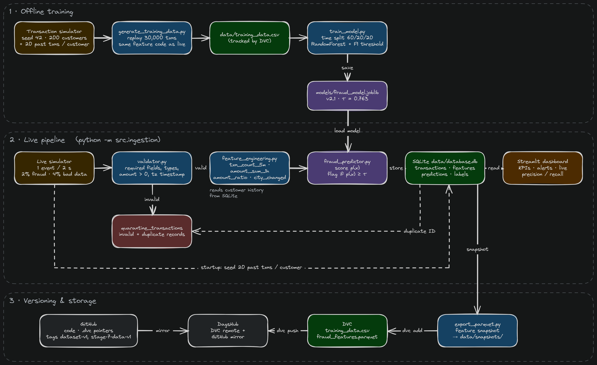
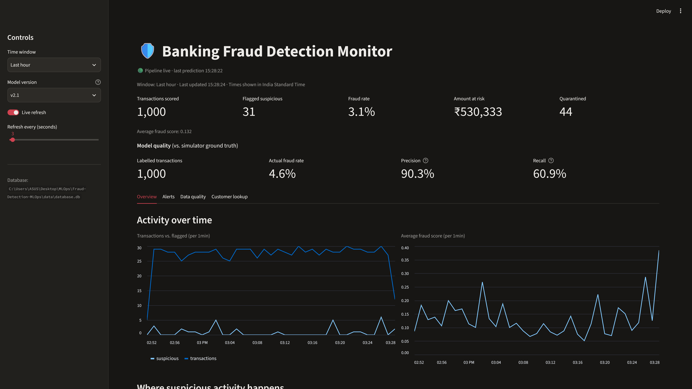

# How the fraud model works

This document explains where the data comes from (the probability
distributions used and where each one lives in the code), how the features
are computed, how the model is trained and how it is evaluated, both offline
and live on the dashboard.

---

## 1. Synthetic data: distributions and where they are used

All data is produced by `TransactionSimulator` in
[`src/transaction_generator.py`](../src/transaction_generator.py). The same
simulator feeds both the training replay and the live pipeline, so the model
is trained on the distribution it sees in production.

Notation: $\text{LogNormal}(\mu, \sigma)$ means $e^{X}$ with
$X \sim \mathcal{N}(\mu, \sigma^2)$ (Python's `random.lognormvariate`);
$U(a, b)$ is a continuous uniform; $\text{Bernoulli}(p)$ is a yes/no
event with probability $p$.

### 1.1 Customer profiles (fixed for every run)

Profiles use their own random generator seeded with `PROFILE_SEED = 2026`, so
customer `CUST0042` has the same home city, device and spend every time the
pipeline starts. That keeps the history stored in SQLite consistent with the
customer's behaviour.

| Quantity | Distribution | Where |
|---|---|---|
| Typical spend | $\text{typical}_c = \operatorname{clip}\big(\text{LogNormal}(\ln 2000,\ 0.7),\ 200,\ 20000\big)$ | `_make_customer`, line 89–94 |
| Home city | Uniform over 7 cities | line 92 |
| Usual device | Uniform over Phone / Laptop / Tablet | line 93 |

Why log-normal: spending is positive and right-skewed (most customers spend
modestly, a few spend a lot). $\ln 2000$ puts the **median** typical spend at
₹2,000; $\sigma = 0.7$ gives roughly a 6× spread between the 10th and 90th
percentiles. The clip removes absurd values.

### 1.2 Which event happens next

| Step | Distribution | Where |
|---|---|---|
| Which customer | Uniform over the 200 customers | `next`, line 213 |
| Bad record (live only) | $\text{Bernoulli}(0.04)$, `BAD_DATA_RATE` | `next`, line 214; rate set in `src/ingestion.py`, line 151 |
| Fraud episode starts | $\text{Bernoulli}(0.02)$, `fraud_rate` | `next`, line 216 |
| Otherwise | normal transaction | `_normal` |

### 1.3 Normal transactions

| Field | Distribution | Where |
|---|---|---|
| Amount | $\text{typical}_c \times \text{LogNormal}(0,\ 0.5)$ | `_normal`, line 113 |
| City | home city with prob. 0.95, else uniform over all cities | lines 114–118 |
| Device | usual device with prob. 0.9, else uniform | lines 119–123 |
| Merchant | uniform over 6 merchants | `_build`, line 106 |

$\text{LogNormal}(0, 0.5)$ has median 1, so a customer's transactions
scatter around their typical spend (the middle 50% fall between about 0.7×
and 1.4×). The 5% of normal transactions in another city and 10% on another
device are deliberate noise: they keep `city_changed` from being a perfect
fraud signal.

### 1.4 Fraud episodes

When a fraud episode starts (`_start_fraud`, lines 126–150) three
independent coin flips decide what kind it is:

| Pattern | Probability | Effect |
|---|---|---|
| Amount spike | 0.7 | amount $= \text{typical}_c \times U(4,\ 15)$, otherwise $\text{typical}_c \times U(0.8,\ 2)$ (line 141) |
| New city | 0.6 | a city other than the home city, uniform (line 134) |
| Burst | 0.5 | $\text{UniformInt}(2,\ 5)$ more fraud transactions follow immediately (line 145) |
| (always) | – | device is uniform random (line 138) |

If all three flips come up "no", the episode is forced to be a spike, so
every fraud has at least one detectable pattern. Some frauds are still
deliberately hard: a no-spike, no-burst episode in a new city has an amount
of $0.8$–$2\times$ typical spend, which overlaps with normal behaviour.

Because bursts add extra fraud rows, the share of fraudulent **transactions**
is higher than the 2% episode rate: about 5% (5.3% in the training data).

### 1.5 Bad records (live stream only)

With probability 0.04 a live event is replaced by a corrupted record
(`_corrupt`, lines 152–180). The corruption type is uniform over 9 kinds:
a missing field, a blank field, a negative / zero / text / NaN amount, an
unparseable timestamp, a timestamp without a timezone, or a re-send of a
recently accepted transaction (duplicate ID). The validator or the
`transaction_id` primary key catches each one and it goes to
`quarantine_transactions`. Training data never contains bad records.

### 1.6 Customer back-history

`history()` (lines 182–198) creates 20 normal transactions per customer
(`HISTORY_PER_CUSTOMER`), each timestamped $U(8,\ 30)$ days before the
start (`HISTORY_DAYS`). Both the live pipeline (`warm_up_history` in
`src/ingestion.py`) and the training replay insert this history first, so a
customer's very first scored transaction already has an average spend and a
last city to compare against.

### 1.7 Timing

| Stream | Spacing between events | Where |
|---|---|---|
| Live | fixed 2 s sleep (`EVENT_INTERVAL_SECONDS`) | `src/ingestion.py`, `main` |
| Training replay | $U(1,\ 3)$ s, mean 2 s, seeded with 42 | `scripts/generate_training_data.py`, line 43 |

Matching the average spacing matters: `txn_count_5m` and `amount_sum_1h`
depend on how many events fit in a time window.

---

## 2. Features

Computed by `calculate_features` in
[`src/feature_engineering.py`](../src/feature_engineering.py), the same
function for training and serving. For a transaction by customer $c$ at
time $t$ with amount $a$, only the customer's **earlier** transactions
$H_c(t) = \{\, j : c_j = c,\ t_j < t \,\}$ are used, so there is no leakage
from the future:

$$
\begin{aligned}
\texttt{txn\_count\_5m} &= \big|\{\, j \in H_c(t) : t_j \ge t - 5\,\text{min} \,\}\big| \\
\texttt{amount\_sum\_1h} &= \sum_{j \in H_c(t),\ t_j \ge t - 1\,\text{h}} a_j \\
\texttt{avg\_prior\_amount} &= \frac{1}{|H_c(t)|} \sum_{j \in H_c(t)} a_j \\
\texttt{amount\_ratio} &= \frac{a}{\texttt{avg\_prior\_amount}} \\
\texttt{city\_changed} &= \mathbb{1}\big[\,\text{city} \ne \text{city of the latest } j \in H_c(t)\,\big]
\end{aligned}
$$

| Feature | Catches | Fraud pattern |
|---|---|---|
| `amount` | large absolute amounts | spike |
| `amount_ratio` | amounts unusual *for this customer* | spike |
| `city_changed` | location jumps | new city |
| `txn_count_5m` | many transactions in a few minutes | burst |
| `amount_sum_1h` | heavy spending in the last hour | burst |

With no history, `amount_ratio` is missing and `city_changed` is 0; the
back-history in §1.6 makes that rare.

---

## 3. Model

Defined in [`scripts/train_model.py`](../scripts/train_model.py) as a
scikit-learn `Pipeline`:

1. **`SimpleImputer(strategy="median")`** fills a missing `amount_ratio` with
   the training median.
2. **`RandomForestClassifier`**: 200 trees, `max_depth=10`,
   `min_samples_leaf=5`, `class_weight="balanced"`.

**Random forest.** Each tree is trained on a bootstrap sample of the rows
and considers a random subset of features at each split. Averaging many
decorrelated trees reduces variance compared with a single tree. Trees need
no feature scaling and handle interactions such as "high `amount_ratio`
*and* `city_changed`" naturally.

**Class weights.** Fraud is only ~5% of rows, so the "balanced" setting
weights each class inversely to its frequency:

$$
w_k = \frac{n}{2\, n_k}
$$

With 5.3% fraud that makes each fraud row count about 18× as much as a normal
row, so the trees do not simply learn to predict "normal".

**Score and decision.** The fraud score is the trees' average fraud
probability; a transaction is flagged when it reaches the threshold $\tau$
(`src/fraud_predictor.py`, lines 34–38):

$$
p(x) = \frac{1}{200} \sum_{m=1}^{200} p_m(\text{fraud} \mid x),
\qquad
\texttt{is\_suspicious} = \mathbb{1}\big[\,p(x) \ge \tau\,\big]
$$

The saved artifact `models/fraud_model.joblib` holds the pipeline, the
feature list, $\tau$, the version (`v2.1`) and the test metrics.

---

## 4. Training and threshold selection

**Data.** 30,000 transactions replayed by
`scripts/generate_training_data.py` (seed 42), after the customer
back-history.

**Time-based split** (lines 50–52), never shuffled, because in production
the model always scores transactions that happen *after* its training data:

| Split | Rows | Used for |
|---|---|---|
| Train | first 60% | fitting the forest |
| Validation | next 20% | choosing $\tau$ |
| Test | last 20% | final, untouched evaluation |

**Threshold.** A 0.5 cut-off is not meaningful with class weights and
imbalance, so $\tau$ is tuned. `best_f1_threshold` (lines 36–43) sweeps every
candidate threshold on the validation set with `precision_recall_curve` and
keeps the one with the highest F1:

$$
\tau = \arg\max_{\tau}\ F_1(\tau) \quad \text{on validation}
$$

---

## 5. Evaluation metrics

Counts, with fraud as the positive class:

| | Flagged | Not flagged |
|---|---|---|
| **Fraud** | TP (caught) | FN (missed) |
| **Normal** | FP (false alarm) | TN |

$$
\text{Precision} = \frac{TP}{TP + FP}
\qquad
\text{Recall} = \frac{TP}{TP + FN}
\qquad
F_1 = \frac{2 \cdot \text{Precision} \cdot \text{Recall}}{\text{Precision} + \text{Recall}}
$$

- **Precision**: of the alerts raised, the share that were real fraud. Low
  precision means analysts waste time on false alarms.
- **Recall**: of the real frauds, the share that were caught. Low recall
  means fraud gets through.
- **F1**: the harmonic mean of the two; it is high only when both are.

Threshold-free metrics, computed from the raw scores (lines 77–78):

- **ROC AUC** (`roc_auc_score`): the area under the true-positive-rate vs
  false-positive-rate curve. Equivalently, the probability that a randomly
  chosen fraud gets a higher score than a randomly chosen normal
  transaction: $\text{AUC} = P\big(p(x_{\text{fraud}}) > p(x_{\text{normal}})\big)$.
  0.5 is random guessing, 1.0 is perfect.
- **PR AUC / average precision** (`average_precision_score`):
  $\text{AP} = \sum_k (R_k - R_{k-1})\, P_k$, the precision averaged over
  recall levels. With rare fraud this is the more honest metric: a random
  model scores only the fraud rate (~0.05), whereas its ROC AUC would still
  be 0.5.

### 5.1 Offline results: model v2.1 (test set, 6,000 rows)

| Metric | Value |
|---|---|
| Threshold $\tau$ | 0.763 |
| Precision (fraud) | 0.856 |
| Recall (fraud) | 0.796 |
| F1 (fraud) | 0.825 |
| ROC AUC | 0.973 |
| PR AUC | 0.881 |
| Actual fraud rate / flag rate | 5.5% / 5.1% |

Confusion matrix: 261 frauds caught, 67 missed, 44 false alarms, 5,628
correct normals.

### 5.2 Live monitoring on the dashboard

The simulator's ground-truth label is stored in `transaction_labels` (never
shown to the model), so the dashboard (`render_model_quality` in
`app/dashboard.py`) computes **live** precision and recall with the same
formulas over the selected time window.

On the dashboard:

- **Fraud rate** is the *flag* rate: flagged ÷ scored.
- **Actual fraud rate** is the true rate from the labels.
- **Quarantined** counts the bad records rejected in the window.

The live numbers move more than the offline ones because they are measured
on far fewer frauds. In the screenshot, 1,000 transactions contain about 46
frauds, so each missed fraud moves recall by about 2 points. A sustained gap
between live and test metrics is the signal to investigate drift or retrain.
